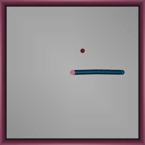

# robot-policy-evals

Training and evaluating learned robot control policies in simulation. The question
running through this repo: when a learned policy improves, does the improvement hold up
under new conditions, and which failures appear when those conditions change?

Status: started 2026-10-18, on step 2 of 7.



*A random policy on Reacher-v5, top-down view at half speed. Pink is the arm's base,
green the fingertip, red the target.*

## Plan

1. Run the simulation and understand observations, actions and rewards. (`explore_env.py`)
2. Measure a random-policy baseline on held-out evaluation seeds. (`task1_random_baseline.py`)
3. Train a small neural-network policy with a standard RL implementation (Stable-Baselines3).
4. Walk through one update of the learning algorithm by hand.
5. Evaluate distance-to-target and a success criterion fixed in advance, on held-out
   evaluation seeds, across several independent training runs.
6. Add observation noise and investigate which failures increase.
7. Save configurations, results and plots, and write a short research write-up.

It starts with state observations. Vision and physical hardware come later.

## The environment: Gymnasium Reacher-v5 (MuJoCo)

A two-joint arm on a table has to touch a target. One step is 0.02 s of simulated time
and an episode lasts 50 steps (1 s). The arm reaches 0.21 m from its base; each episode
places the target at random within 0.20 m of the base.

**Observation (10 numbers).** Cosine and sine of the two joint angles, target x and y,
the two joint angular velocities, and the fingertip-minus-target vector (x, y).

**Action (2 numbers in [-1, 1]).** Torque on the shoulder joint and on the elbow joint.

**Reward per step.** `-(distance from fingertip to target) - (sum of squared actions)`.
The distance is measured after the step. The control-cost weight is 1: the Gymnasium
1.4.0 docs say 0.1, but the code uses 1, and `explore_env.py` measures it directly.

## Run it

Requires [uv](https://docs.astral.sh/uv/).

```bash
uv run explore_env.py
```

## Notes

The lab notebook (`NOTEBOOK.md`) records each prediction before the run that tests it.
The learning-rate warm-up that preceded this repo is in
[ml-foundations](https://github.com/di-omics/ml-foundations).
